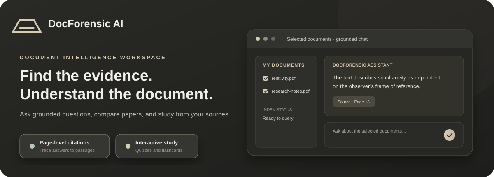
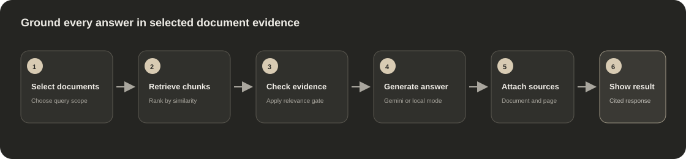
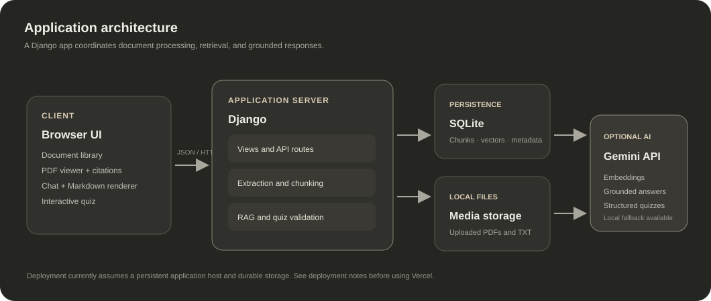

# DocForensic AI

**Ask questions across your PDFs and text files, study from their contents, and follow each answer back to its source.**

DocForensic AI is a Django document intelligence app with retrieval-augmented generation (RAG). It extracts text from uploaded PDF and TXT files, retrieves relevant passages from the documents selected in the interface, and returns answers with page-level source references. It also includes document comparison, grounded study tools, and a scored multiple-choice quiz.

> This repository contains the application source code. Uploaded documents, extracted user data, local database files, and API keys are excluded.



## Contents

- [Highlights](#highlights)
- [How it works](#how-it-works)
- [Technology](#technology)
- [Quick start](#quick-start)
- [Gemini configuration](#gemini-configuration)
- [Using the app](#using-the-app)
- [HTTP API](#http-api)
- [Configuration reference](#configuration-reference)
- [Project layout](#project-layout)
- [Tests](#tests)
- [Privacy and security](#privacy-and-security)
- [Deployment notes](#deployment-notes)
- [Troubleshooting](#troubleshooting)

## Highlights

- **Document library:** upload, select, view, and delete PDF and TXT files from the sidebar.
- **Grounded chat:** retrieve passages from explicitly selected documents and cite supporting sources by document and page.
- **Evidence threshold:** report when the selected content does not support an answer instead of presenting unrelated passages as evidence.
- **Compare papers:** select two or more documents to compare their coverage, findings, methods, or claims.
- **Learning tools:** request explanations and flashcards, or generate a multiple-choice quiz with topic, difficulty, and question-count options.
- **Interactive quizzes:** answer one question at a time, check a score, review explanations, and open cited document pages.
- **Markdown answers:** format headings, lists, tables, blockquotes, citations, and fenced code with syntax highlighting and copy controls.
- **Math and diagrams:** render KaTeX math and Mermaid diagrams with copy-source and expand controls.
- **Upload progress:** show progress while a document is uploaded and indexed.
- **Local fallback:** use deterministic local hash-vector embeddings and extractive answers when Gemini is not configured.
- **Responsive workspace:** navigate the document library, page viewer, metadata, processing stats, and chat from one interface.
- **Public portfolio demo:** try a synthetic sample report without a password. Demo access is read-only and limited to 20 shared questions per day; private documents and write APIs remain password-gated.

## How it works



1. The browser sends a PDF or TXT file to Django.
2. Django validates the extension and size, extracts readable text, and splits it into overlapping chunks.
3. Each chunk keeps its document and page information. The app stores chunks and their embeddings in SQLite.
4. For a question, the app searches only the selected, indexed documents and ranks passages by cosine similarity.
5. If the evidence gate accepts the retrieved passages, the app asks Gemini to answer using that context alone. When Gemini is disabled, a local extractive response is used for regular chat.
6. The response includes source references. The interface formats the answer as sanitized Markdown and allows citations to jump to the referenced page.

The quiz endpoint follows the same selected-document scope, requests structured JSON, validates the question/answer format and source references on the server, and returns citations tied to uploaded pages. The browser withholds correct answers until the learner submits all responses.

## Technology

| Component | Technology |
| --- | --- |
| Web application | Django 6, Python 3.12+ |
| Interface | Django templates, HTML, CSS, vanilla JavaScript |
| Database | SQLite for local development |
| PDF extraction | `pypdf` |
| Generative model | Google Gemini via `google-genai` |
| Semantic vectors | Gemini embeddings, with a local hash-vector fallback |
| Retrieval | Cosine similarity over stored chunk embeddings |
| Answer formatting | Marked, DOMPurify, Highlight.js, KaTeX, Mermaid (loaded from pinned jsDelivr versions) |

## Quick start

### 1. Requirements

- Python 3.12 or newer
- Git (if cloning this repository)
- A Gemini API key for generated answers, semantic embeddings, and quiz creation (optional for local fallback mode)

### 2. Clone and set up an environment

```bash
git clone https://github.com/Mr-PratikTikhe/DocForensicAI.git
cd DocForensicAI
python -m venv .venv
```

Activate it:

**Windows PowerShell**

```powershell
.\.venv\Scripts\Activate.ps1
```

**macOS or Linux**

```bash
source .venv/bin/activate
```

Install dependencies and create the local configuration file:

```bash
python -m pip install --upgrade pip
python -m pip install -r requirements.txt
```

```powershell
# Windows PowerShell
Copy-Item .env.example .env
```

```bash
# macOS or Linux
cp .env.example .env
```

Edit `.env` to add your Gemini key, then migrate and run Django:

```bash
python manage.py migrate
python manage.py runserver
```

Open <http://127.0.0.1:8000/>.

## Gemini configuration

Create an API key in [Google AI Studio](https://aistudio.google.com/app/apikey) and put it in the root `.env` file:

```dotenv
GEMINI_API_KEY=your_key_here
GEMINI_MODEL=gemini-3.8-flash
GEMINI_FALLBACK_MODEL=gemini-3.5-flash-lite
GEMINI_EMBEDDING_MODEL=gemini-embedding-001
```

Use model IDs that are available to your Google AI Studio project. If a model is missing or quota-limited, change the relevant model setting to an ID currently enabled for your key. Restart Django after changing `.env`.

The API key is optional. With `GEMINI_API_KEY` empty, the app uses local hash-vector retrieval and extractive answers for ordinary chat. Gemini-backed quiz generation and structured research features need a working Gemini key and model access.

If documents were indexed with one embedding provider and you change providers, re-upload those documents so stored vectors use the same provider as the query vectors.

## Using the app

1. Upload a text-based PDF or TXT file. The configured upload limit defaults to 15 MB.
2. Wait for extraction and indexing to complete. The document appears in the sidebar with its current status.
3. Select the document or documents to use for your question. The app searches the selected scope.
4. Ask a question in the chat. Use page citations to inspect the supporting text in the viewer.
5. Use the feature carousel to compare selected documents, explain concepts, make flashcards, or create an interactive quiz.
6. In quiz setup, choose a topic (optional), difficulty, and number of questions. Answer the full quiz and select **Check answers** to see your score and explanations.
7. Use the `×` control next to a document to delete it from the local library.

Scanned or image-only PDFs may not contain extractable text. This version does not perform OCR; upload a searchable PDF or a TXT export instead.

## HTTP API

The browser interface is served by the same Django app. Modifying endpoints require Django CSRF protection.

| Method | Path | Purpose |
| --- | --- | --- |
| `GET` | `/` | Render the web interface |
| `GET` | `/api/documents/` | List uploaded document metadata |
| `POST` | `/api/documents/upload/` | Upload, extract, and index a PDF/TXT document |
| `GET` | `/api/documents/<id>/chunks/` | Get the document and page-tagged text chunks |
| `DELETE` | `/api/documents/<id>/` | Delete a document, its chunks, and its uploaded file |
| `POST` | `/api/ask/` | Retrieve evidence and answer a question |
| `POST` | `/api/quiz/` | Generate a validated, document-grounded quiz |
| `GET` | `/admin/` | Django administration |

### Ask request

`POST /api/ask/` accepts JSON:

```json
{
  "question": "What does the paper say about simultaneity?",
  "document_ids": [1]
}
```

To use one of the research features, include an allowed `feature_mode`, such as `compare`, `explain`, `flashcards`, `literature_review`, `research_gaps`, or `knowledge_map`. Normal questions use `feature_mode: null` or omit it.

### Quiz request

`POST /api/quiz/` accepts JSON:

```json
{
  "document_ids": [1, 2],
  "question_count": 5,
  "difficulty": "medium",
  "topic": "Special relativity"
}
```

Allowed question counts are 3, 5, 8, or 10. Difficulty is `easy`, `medium`, or `hard`. Leave `topic` empty to draw questions from general concepts in the selected documents.

## Configuration reference

| Variable | Default | Purpose |
| --- | --- | --- |
| `GEMINI_API_KEY` | Empty | Enables Gemini embeddings, generation, and structured quiz creation |
| `GEMINI_MODEL` | `gemini-3.8-flash` | Primary Gemini generation model |
| `GEMINI_FALLBACK_MODEL` | `gemini-3.5-flash-lite` | Backup model used for temporary primary-model failures |
| `GEMINI_EMBEDDING_MODEL` | `gemini-embedding-001` | Gemini model used for text embeddings |
| `DJANGO_SECRET_KEY` | Development-only fallback | Django signing and session secret; set a strong private value for deployment |
| `DJANGO_DEBUG` | `true` | Django debug mode; set to `false` in production |
| `DJANGO_ALLOWED_HOSTS` | `localhost,127.0.0.1` | Comma-separated allowed hostnames |
| `MAX_UPLOAD_SIZE_MB` | `15` | Maximum upload size in MB |

See [.env.example](.env.example) for a safe starting template. Never put credentials in the README, source files, screenshots, or a committed `.env` file.

## Project layout

```text
DocForensicAI/
├── assistant/
│   ├── migrations/                 # Django database migrations
│   ├── services/
│   │   ├── embeddings.py           # Gemini and local embedding functions
│   │   ├── extraction.py           # PDF/TXT text extraction and chunking
│   │   ├── learning.py             # Structured quiz generation and validation
│   │   ├── processing.py           # Document processing pipeline
│   │   └── rag.py                  # Retrieval, evidence checks, grounded answers
│   ├── static/assistant/
│   │   ├── css/app.css             # Charcoal, sand, and silver UI styles
│   │   └── js/app.js               # Document, chat, Markdown, and quiz UI
│   ├── templates/assistant/        # Main Django template
│   ├── tests.py                    # App tests
│   ├── urls.py                     # App URL routes
│   └── views.py                    # Web and JSON API views
├── docs/images/                    # README illustrations and diagrams
├── docintel/                       # Django project settings and root routes
├── .env.example                    # Safe environment-variable template
├── .gitignore                      # Excludes local secrets and generated data
├── manage.py
└── requirements.txt
```

### Component diagram



## Tests

Run Django’s checks and the assistant test suite:

```bash
python manage.py check
python manage.py test assistant
```

The tests cover text chunking and page metadata, relevant and unrelated retrieval, uploads, unsupported file types, input validation, and quiz source validation.

## Privacy and security

- `.env`, SQLite database files, the virtual environment, uploaded `media/`, and generated static output are ignored by Git.
- Keep your Gemini API key private and configure it through environment variables.
- Markdown HTML is sanitized before being rendered in the chat. Mermaid runs with strict security settings.
- Document selection is passed explicitly to retrieval; uploaded documents are not sent to Gemini as a whole. Retrieved passages are included for generation.
- The beta uses a shared password gate. Everyone with the password sees the same document library and can upload or delete documents; per-user isolation is not implemented.
- The local SQLite database and uploaded files are for development only. Vercel production requires persistent PostgreSQL and private object storage.

## Deployment notes

Vercel recognizes this Django project from `manage.py` and `WSGI_APPLICATION`. Before the first production deployment, connect a persistent PostgreSQL database and a **private** Vercel Blob store. The app deliberately refuses to start in production if either is missing; the serverless filesystem and SQLite database are temporary and must not hold the document library.

Set these project environment variables in Vercel:

- `DJANGO_SECRET_KEY`: a new, random secret used only by the deployed site.
- `DJANGO_DEBUG=false`
- `DJANGO_ALLOWED_HOSTS`: the Vercel domain, such as `docforensicai.vercel.app`.
- `DJANGO_CSRF_TRUSTED_ORIGINS`: the matching HTTPS origin, such as `https://docforensicai.vercel.app`.
- `SITE_ACCESS_PASSWORD`: the shared private-beta password. Everyone who has it shares the same document library and can upload or delete documents.
- `DATABASE_URL`: the PostgreSQL provider's connection URL.
- `GEMINI_API_KEY`: add this yourself in Vercel project settings; do not commit it.
- `BLOB_READ_WRITE_TOKEN`: injected when the private Blob store is connected.

The server upload route is limited to 4 MB by default on Vercel because Vercel Functions cap request bodies at 4.5 MB. Set `MAX_UPLOAD_SIZE_MB` no higher than `4` until browser-to-Blob uploads are implemented. Local development keeps its 15 MB default.

After connecting the database, run `python manage.py migrate` against its production `DATABASE_URL` before opening the beta. Static files are collected automatically by Vercel's Django support. See [Vercel's Django guide](https://vercel.com/docs/frameworks/full-stack/django), [Vercel Blob private storage](https://vercel.com/docs/vercel-blob/private-storage), and [Vercel storage overview](https://vercel.com/docs/storage).

To refresh the public sample after deployment, run `python manage.py seed_demo_library` with the production database and Blob credentials. This loads the synthetic report plus the two small source PDFs in `demo_sources/`. The PDFs are Max Planck's [The Origin and Development of the Quantum Theory](https://www.gutenberg.org/ebooks/33663) (Project Gutenberg lists it as public domain in the USA) and Albert Einstein's [Relativity: The Special and General Theory](https://www.ibiblio.org/ebooks/Einstein/index.html) (ibiblio lists the original book as public domain in the USA and notes that copyright can differ by country). The demo query accepts only selected, ready demo document IDs and searches all selected documents. To change the private-beta password, update `SITE_ACCESS_PASSWORD` in Vercel Project Settings → Environment Variables for Production, save, then redeploy. Update your ignored local `.env.beta-access` note separately if you want it to match; Django does not load that file.

For production beyond this shared-password beta, add individual accounts and per-user document permissions before allowing separate groups of users to share the service.

## Troubleshooting

### `ModuleNotFoundError: No module named 'django'`

Activate the project’s virtual environment and install requirements:

```bash
python -m pip install -r requirements.txt
```

### Gemini reports that a model is not found

The configured model may not be available to your API project. Set `GEMINI_MODEL` (and, if needed, `GEMINI_FALLBACK_MODEL`) to model IDs shown as available for your key, then restart Django.

### Gemini reports rate limits or temporary unavailability

Check the model and embedding quotas for your Google AI Studio project. The app falls back to its configured backup model for temporary generation failures. Repeated embedding requests can also happen when uploading/reprocessing files or querying chunks indexed with Gemini embeddings.

### The app cannot find an answer

Confirm that the relevant document is selected, indexed, and contains readable text. Try a specific question using a heading or phrase from the document. Broad questions depend on whether the retrieval step surfaces a sufficiently relevant passage.

### Scanned PDF has no readable text

This version extracts embedded PDF text but does not run OCR. Use OCR to create a searchable PDF or text export before uploading.

### Django rejects the host

Add the host to `DJANGO_ALLOWED_HOSTS` in `.env` and restart the server.

## License

No license has been added yet. All rights reserved unless a license is added to this repository.
